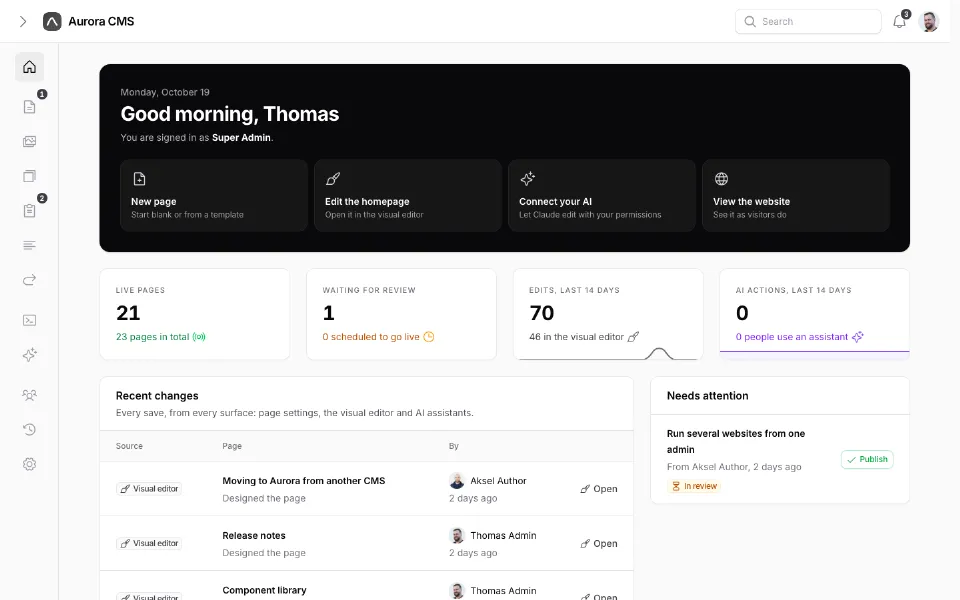

# Minimal

[](https://packagist.org/packages/shipaurora/minimal)
[](https://packagist.org/packages/shipaurora/minimal)
[](https://www.php.net)
[](https://laravel.com)
[](https://filamentphp.com)
[](LICENSE)

A quiet admin theme for [Aurora](https://shipaurora.com), a content management system for
Laravel built on [Filament](https://filamentphp.com). Neutral greys, thin lines and nothing that
glows, in light and dark.



## Features

- **Light and dark mode.** Everyone picks their own in the user menu, or in the command palette
  (⌘K).
- **The whole admin.** Filament's panels and forms, and Aurora's own screens: the visual editor,
  its inspector, the media library and the settings.
- **Prebuilt.** The stylesheet ships compiled in `resources/dist/theme.css`, so installing it needs
  no build step.
- **A starting point.** A small, flat theme that's easy to copy when you make your own.

## Requirements

- PHP 8.4 or newer
- [Aurora](https://github.com/shipaurora/cms) (`shipaurora/cms`), with Filament 5.10.3 or newer

## Installation

```bash
composer require shipaurora/minimal
php artisan filament:assets
```

`filament:assets` copies the stylesheet to `public/css/shipaurora/minimal-theme`. Run it again
after updating the package.

## Usage

Once installed, Minimal is one of the themes under **Settings › Appearance**. The choice applies to
everyone who works in the admin.

To make it the theme from configuration instead, until someone chooses one in Settings, set
`AURORA_THEME` in `.env`:

```dotenv
AURORA_THEME=minimal
```

## Making your own theme

A theme is a package that registers itself with Aurora. Minimal's service provider
(`src/ThemeServiceProvider.php`) shows the whole registration, and its stylesheets in
`resources/css` restyle Aurora's `cms-*` hooks with a handful of tokens. Aurora's documentation
covers writing a theme.

## Development

The compiled stylesheet in `resources/dist/theme.css` is built from the sources in
`resources/css`, which import Filament's theme and Aurora's components. It's built in Aurora's
development setup, where those packages are installed next to it.

## License

Minimal is open-source software licensed under the [MIT license](LICENSE).
